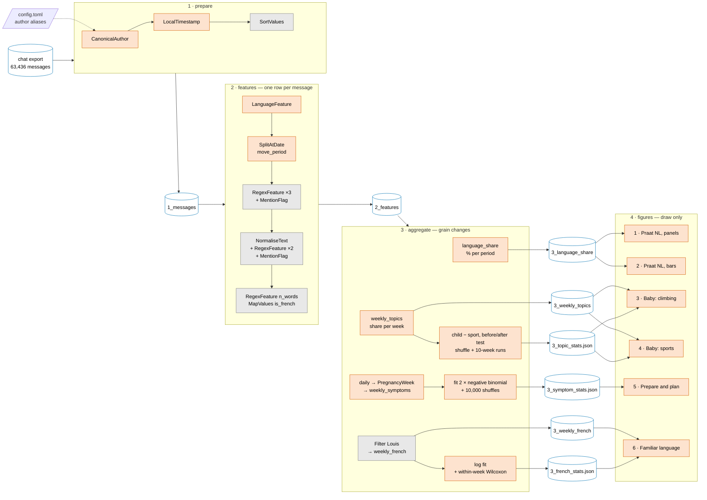
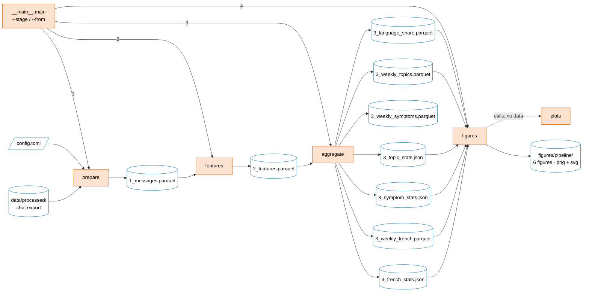

# roos_pipeline

My WhatsApp chat with Louis, from raw export to six figures, in one command:

```bash
uv run python -m roos_pipeline                   # all four stages, ~13 s
uv run python -m roos_pipeline --stage figures   # only redraw (needs stage 3's files)
uv run python -m roos_pipeline --from aggregate  # aggregate + figures
uv run pytest tests/roos_pipeline                # the tests (no real chat needed)
```

| # | Figure | From notebook | Output |
|---|---|---|---|
| 1 | Praat Nederlands met mij (two panels) | `roos_01.4`, code cell 13 | `figures/pipeline/1_praat_nederlands_panels` |
| 2 | Praat Nederlands met mij (one axes) | `roos_02.5`, code cell 5 | `figures/pipeline/2_praat_nederlands_bars` |
| 3 | Baby is taking over (climbing) | `roos_03.3`, code cell 6 | `figures/pipeline/3_baby_taking_over_climbing` |
| 4 | Baby is taking over (sports) | `roos_03.3`, code cell 7 | `figures/pipeline/4_baby_taking_over_sports` |

Figures 3 and 4 carry a statistical test underneath: the weekly gap *child share − sport
share*, before vs. after the positive test (the test week itself left out), checked with a
shuffle of the before/after label (10,000×) and, keeping the order of time, against every
run of 10 consecutive weeks before the test. Same two checks as figure 5.
| 5 | How to survive a pregnancy: prepare and plan | `roos_04.6d`, code cell 11 | `figures/pipeline/5_prepare_and_plan` |
| 6 | Familiar language needs fewer words | `roos_05.6`, code cell 14 | `figures/pipeline/6_familiar_language_fewer_words` |

Figure 6 is one dot per long-distance week (Louis's French share against his median
words per message) with the line `words = a + b · ln(share)`. Underneath: within each
week, his French messages against his English and Dutch ones (median words, at least 5
of each), checked with a one-sided Wilcoxon signed-rank test over the weeks.

## The flowchart



Grey = a goad_toolkit class used as-is (`RegexFeature`, `SortValues`, `MapValues`,
`Filter`, `RegPlot`; boxes marked "+" combine both, and "Filter Louis → weekly_french"
is goad's `Filter` followed by my own weekly step); orange = my own code; blue cylinders = files on disk in
`data/processed/roos/` (gitignored: the chat never enters git).

## The flowchart as atlas reads it

The chart above is drawn by hand. This one is copied from what
[atlas](https://github.com/raoulg/atlas) reads in the code itself (`atlas serve`,
part `roos_pipeline`; `route` of `main`), so it shows what the code *does*, not what
I meant it to do. Boxes are modules, cylinders are the files atlas sees them read
and write; the numbers on `main`'s arrows are the order of the calls in
`run_stages`, each only when that stage is selected (`--stage` / `--from`).



`3_weekly_symptoms.parquet` has no arrow out: aggregate writes it, but no stage reads
it (the figure uses `3_symptom_stats.json`; only `test_pipeline.py` opens it). `vectors` is left out: it is not part of
the pipeline yet.

To redraw it yourself: `atlas serve` in the repository, open part `roos_pipeline`, and
shift-click the package to focus on it.

## Why the boundaries sit where they do

Every arrow between two stages is a file. That is the whole design.

| Boundary | What changes there | If the two sides were merged… | Rerun on its own? |
|---|---|---|---|
| prepare → features | nothing about the content: names and timestamps are fixed *once* | every feature step would have to repeat the alias/timezone handling, and a forgotten alias would split Louis in two in some figures only | yes, from `1_messages` |
| features → aggregate | **the grain**: one row per message becomes one row per period or week | a new topic or language rule would force re-running the shuffle test, and per-message columns could no longer be checked (`2_features` is the file to open when a regex looks wrong) | yes, from `2_features` |
| aggregate → figures | statistics become pictures | changing a title or a colour would re-run 3 × 10,000 shuffles and the fits; the figures stage reads five small files and runs in a second | yes, from the `3_*` files |

The test `test_figures_stage_needs_only_the_stage_3_files` deletes stages 1 and 2's
output and redraws anyway: that's the claim in the last column, checked.

## The base classes, and what I built on them

From **goad_toolkit** (installed with `uv`, pinned in `uv.lock`):

- **`TransformBase`** (`datatransforms.py`): an abstract class with one method to fill
  in, `transform(data, **params) -> DataFrame`. Its `__call__` first checks that a
  `column=` parameter exists in the frame, then calls `transform` with the parameters
  given at construction. Every step in this pipeline is one of these.
- Figure 6's line is goad's **`RegPlot`** with `logx=True`: the docstring's point, that
  the choice of fit is a claim about the relationship, is why the line is the log of x
  (roos_05.6 §5.6.5) and not seaborn's default straight one.
- **`Pipeline`**: holds steps *as classes plus parameters* (`add` does not run
  anything) and runs them in order in `apply`, on one copy of the input, so the frame
  passed in is never changed. Steps are named, so `pipeline["move_period"]` shows a
  step's settings, and `apply(..., keep_intermediate=True)` + `report()` shows which
  step added which column.
- **`BasePlot`** (`visualizer.py`): an abstract class with one method to fill in,
  `build(...)`. `plot()` creates the figure from a **`PlotSettings`** (size, title,
  labels, `base_color`/`highlight_color`, `highlight`) and then calls `build`.
  `plot_on(other)` hands this figure's axes to another `BasePlot`, so classes stack
  as layers.
- Used as-is: `RegexFeature`, `SortValues`, `RollingAvg`, `LinePlot`,
  `NullDistribution`, `Filter`, `MapValues`, `RegPlot`.

From **scripts/** (the teacher's, unchanged): `BarPlot`, which `LabelledBarPlot` extends.

My classes:

| Class | Base | Stage | Job |
|---|---|---|---|
| `CanonicalAuthor` | `TransformBase` | prepare | merge Louis's three display names (explicit map in `config.toml`) |
| `LocalTimestamp` | `TransformBase` | prepare | string → the phone's wall-clock time |
| `LanguageFeature` | `TransformBase` | features | en/nl/fr per message, "unknown" under 3 characters |
| `SplitAtDate` | `TransformBase` | features | before/after the move |
| `MentionFlag` | `TransformBase` | features | count → 0/1 flag; several columns → OR (`sports`) |
| `NormaliseText` | `TransformBase` | features | lowercase, no accents, for the symptom patterns |
| `PregnancyWeek` | `TransformBase` | aggregate | pregnancy week of a date (on days, not messages) |
| `PeriodPanelsPlot` | `BasePlot` | figures | one bar panel per period (figure 1) |
| `LabelledBarPlot` | `BarPlot` (scripts) | figures | the teacher's bar chart + values on the bars (figure 2) |
| `TopicTrendPlot` | `BasePlot` | figures | grey weeks, coloured trend, event markers (figures 3, 4) |
| `PeakLabelledCurves` | `BasePlot` | figures | curves labelled at their peak (figure 5) |

`RiseDeclinePlot`, `DistributionDiffPlot`, `RidgelinePlot`, `ViolinPlot`,
`BeforeAfterDensityPlot`, `DotStripPlot` and `EventMarker` were mine too; they moved
here from `scripts/plots.py` unchanged, and the notebooks now import them from
`roos_pipeline.plots`.

Every date, regex and colour lives in `settings.py`, and nowhere else.

## Which check catches which mistake

| Kind of mistake | Caught by | When |
|---|---|---|
| style, unused import, risky pattern | `ruff` (lefthook) | every commit |
| wrong type, e.g. calling `.rename` on something that may be a DataFrame | `ty` (lefthook) | every commit |
| a step computes the wrong number (week boundaries, OR counted twice, regex matches the wrong word) | `pytest`, unit tests (lefthook, when this folder changes) | commit |
| stages don't fit together; a stage secretly needs an earlier file | `pytest`, `test_pipeline.py` | commit |
| a new export brings a third display name; the hard weeks aren't 10; the subtitle's "three times" no longer holds; figure 6's "p < 0.001" no longer holds | checks inside the pipeline (`check_messages`, `symptom_stats`, `prepare_and_plan`, `familiar_language`) | every run, on the real data |
| a chart that is correct but misleading or ugly (overlapping labels, a doubled axis label) | **looking at it** | after every run |

The tests run on a fake chat built in `tests/roos_pipeline/conftest.py`, never on the
real one, so they also work on a fresh clone.
