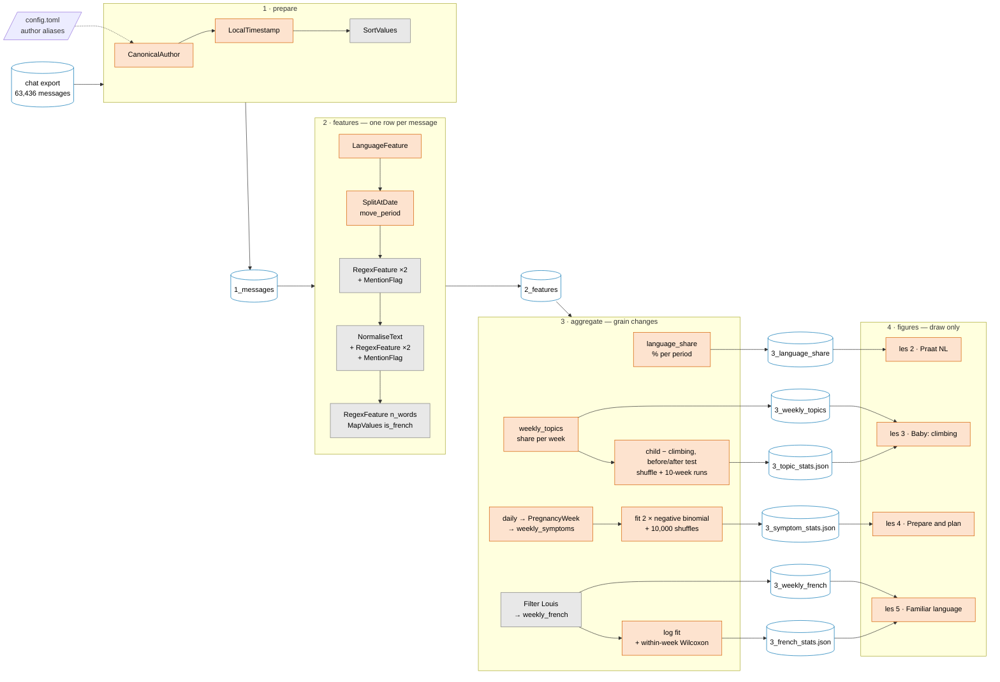
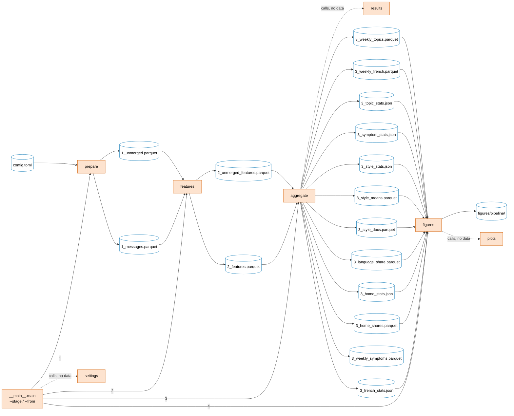

# roos_pipeline

My WhatsApp chat with Louis, from raw export to six figures (one per lesson), in one command:

```bash
uv run python -m roos_pipeline                   # all four stages, ~13 s
uv run python -m roos_pipeline --stage figures   # only redraw (needs stage 3's files)
uv run python -m roos_pipeline --from aggregate  # aggregate + figures
uv run pytest tests/roos_pipeline                # the tests (no real chat needed)
```

| Les | Figure | From notebook | Output (`figures/pipeline/`, .png + .svg) |
|---|---|---|---|
| 2 | Praat Nederlands met mij | `roos_02.5`, code cell 5 | `les_2_praat_nederlands_bars` |
| 3 | Baby is taking over (climbing) | `roos_03.3`, code cell 6 | `les_3_baby_taking_over_climbing_time` |
| 4 | How to survive a pregnancy: prepare and plan | `roos_04.6d`, code cell 11 | `les_4_prepare_and_plan_distributie` |
| 5 | Familiar language needs fewer words | `roos_05.6`, code cell 14 | `les_5_fam_lang_fewer_words_relation` |
| 6 | Roos en Louis groeien naar elkaars Frans toe | `roos_06.6`, code cell 19 | `les_6_frans_roos_louis_high_dim` |
| 7 | De reis van onze relatie: van spontaan op pad naar samen thuis | `roos_07.4`, code cell 24 | `les_7_onderweg_naar_thuis_netwerk` |

The other versions (the two-panel "Praat Nederlands" of roos_01.4 and "Baby is taking
over" with all sports) left the pipeline on 2026-11-13, with the code that only they used.

Every text on the figures is Dutch, like the report, numbers included (10.000, 0,25).

Les 2's subtitle says "verdrievoudigd" and "steekt schril af bij het Frans" in words; `praat_nederlands_bars`
stops the pipeline if the numbers stop saying so.

Les 3 carries a statistical test underneath: the weekly gap *child share − climbing
share*, before vs. after the positive test (the test week itself left out), checked with a
shuffle of the before/after label (10,000×) and, keeping the order of time, against every
run of 10 consecutive weeks before the test. Same two checks as les 4.

Les 5 is one dot per long-distance week (Louis's French share against his median
words per message) with the line `words = a + b · ln(share)`. Underneath: within each
week, his French messages against his English and Dutch ones (median words, at least 5
of each), checked with a one-sided Wilcoxon signed-rank test over the weeks.

## The flowchart



Grey = a goad_toolkit class used as-is (`RegexFeature`, `SortValues`, `MapValues`,
`Filter`, `RegPlot`; boxes marked "+" combine both, and "Filter Louis → weekly_french"
is goad's `Filter` followed by my own weekly step); orange = my own code; blue cylinders = files on disk in
`data/processed/roos/` (gitignored: the chat never enters git).

## The flowchart as atlas reads it

The chart above is drawn by hand. This one is copied from what
[atlas](https://github.com/raoulg/atlas) reads in the code itself (`atlas serve`,
part `roos_pipeline`; `route` of `main`), so it shows what the code *does*, not what
I meant it to do. Boxes are modules, cylinders are the files atlas sees them read
and write; the numbers on `main`'s arrows are the order of the calls in
`run_stages`, each only when that stage is selected (`--stage` / `--from`).

<!-- atlas-flowchart:start (drawn by tools/roos_atlas_flowchart.py, do not edit) -->

<!-- atlas-flowchart:end -->

`3_weekly_symptoms.parquet` has no arrow out: aggregate writes it, but no stage reads
it (the figure uses `3_symptom_stats.json`; only `test_pipeline.py` opens it). `results` holds
the types of the stage-3 JSON files: aggregate builds them, figures reads them back.

## What is *not* in here

`roos_pipeline/` holds only the code of the six figures (Roos's rule, 2026-11-13). What
only the notebooks use lives in `scripts/`, with the `roos_` prefix so it is never
mistaken for the teacher's files there:

| File | For | Tests |
|---|---|---|
| `scripts/roos_settings.py` | the notebooks' flat settings (`settings.MOVE_DATE`, `settings.PLACES`, ...); every value the pipeline also uses is taken from `roos_pipeline.settings` | `tests/roos_scripts/test_topics.py` |
| `scripts/roos_plots.py` | the plot classes of roos_03.3 and roos_04.6 | |
| `scripts/roos_places.py`, `scripts/roos_people.py` | lesson 7's graphs (roos_07.4) | `tests/roos_scripts/` |
| `scripts/roos_vectors.py` | lesson 6's embeddings (roos_06.5, roos_06.6) | `tests/roos_scripts/` |

The notebooks import pipeline code from `roos_pipeline` directly when they use the same
step (`UnmergeMessages`, `EventMarker`, `theme_shares`, ...), so the two cannot drift
apart. Lefthook runs both test folders.

The chart is not drawn by hand any more: on every commit that touches
`roos_pipeline/*.py`, lefthook runs `tools/roos_atlas_flowchart.py`, which reads atlas's
graph (`atlas analyze`) and rewrites the block between the `atlas-flowchart` markers. By
hand: `uv run python tools/roos_atlas_flowchart.py` (`--check` only says if it is stale).
To see it interactively: `atlas serve` in the repository, open part `roos_pipeline`, and
shift-click the package to focus on it.

## Why the boundaries sit where they do

Every arrow between two stages is a file. That is the whole design.

| Boundary | What changes there | If the two sides were merged… | Rerun on its own? |
|---|---|---|---|
| prepare → features | nothing about the content: names and timestamps are fixed *once* | every feature step would have to repeat the alias/timezone handling, and a forgotten alias would split Louis in two in some figures only | yes, from `1_messages` |
| features → aggregate | **the grain**: one row per message becomes one row per period or week | a new topic or language rule would force re-running the shuffle test, and per-message columns could no longer be checked (`2_features` is the file to open when a regex looks wrong) | yes, from `2_features` |
| aggregate → figures | statistics become pictures | changing a title or a colour would re-run 3 × 10,000 shuffles and the fits; the figures stage reads five small files and runs in a second | yes, from the `3_*` files |

The test `test_figures_stage_needs_only_the_stage_3_files` deletes stages 1 and 2's
output and redraws anyway: that's the claim in the last column, checked.

## The base classes, and what I built on them

From **goad_toolkit** (installed with `uv`, pinned in `uv.lock`):

- **`TransformBase`** (`datatransforms.py`): an abstract class with one method to fill
  in, `transform(data, **params) -> DataFrame`. Its `__call__` first checks that a
  `column=` parameter exists in the frame, then calls `transform` with the parameters
  given at construction. Every step in this pipeline is one of these.
- Les 5's line is goad's **`RegPlot`** with `logx=True`: the docstring's point, that
  the choice of fit is a claim about the relationship, is why the line is the log of x
  (roos_05.6 §5.6.5) and not seaborn's default straight one.
- **`Pipeline`**: holds steps *as classes plus parameters* (`add` does not run
  anything) and runs them in order in `apply`, on one copy of the input, so the frame
  passed in is never changed. Steps are named, so `pipeline["move_period"]` shows a
  step's settings, and `apply(..., keep_intermediate=True)` + `report()` shows which
  step added which column.
- **`BasePlot`** (`visualizer.py`): an abstract class with one method to fill in,
  `build(...)`. `plot()` creates the figure from a **`PlotSettings`** (size, title,
  labels, `base_color`/`highlight_color`, `highlight`) and then calls `build`.
  `plot_on(other)` hands this figure's axes to another `BasePlot`, so classes stack
  as layers.
- Used as-is: `RegexFeature`, `SortValues`, `RollingAvg`, `LinePlot`,
  `NullDistribution`, `Filter`, `MapValues`, `RegPlot`.

From **scripts/** (the teacher's, unchanged): `BarPlot`, which `LabelledBarPlot` extends.

My classes:

| Class | Base | Stage | Job |
|---|---|---|---|
| `CanonicalAuthor` | `TransformBase` | prepare | merge Louis's three display names (explicit map in `config.toml`) |
| `LocalTimestamp` | `TransformBase` | prepare | string → the phone's wall-clock time |
| `LanguageFeature` | `TransformBase` | features | en/nl/fr per message, "unknown" under 3 characters |
| `SplitAtDate` | `TransformBase` | features | before/after the move |
| `MentionFlag` | `TransformBase` | features | count → 0/1 flag; several columns → OR (`either`) |
| `NormaliseText` | `TransformBase` | features | lowercase, no accents, for the symptom patterns |
| `PregnancyWeek` | `TransformBase` | aggregate | pregnancy week of a date (on days, not messages) |
| `LabelledBarPlot` | `BarPlot` (scripts) | figures | the teacher's bar chart + values on the bars (les 2) |
| `TopicTrendPlot` | `BasePlot` | figures | grey weeks, coloured trend, event markers (les 3) |
| `PeakLabelledCurves` | `BasePlot` | figures | curves labelled at their peak (les 4) |
| `StyleMapPlot` | `BasePlot` | figures | the style map of our French (les 6) |
| `HomeAwayPlot` | `BasePlot` | figures | places between on-the-road and home themes (les 7) |

`EventMarker` (`BasePlot`) was written for roos_03.3; `TopicTrendPlot` is built from it.

## Settings and types

Every date, regex, colour and path lives in `settings.py`, and nowhere else, as
pydantic classes per kind (2026-11-13):

| Class | Kind | Inherits |
|---|---|---|
| `Timeline` | the story's dates, pregnancy weeks | `Frozen` |
| `Categories` | authors, languages, periods, the two topics of les 3 | `Frozen` |
| `Patterns` | every regex | `Frozen` |
| `WordLists` | stopwords, function words, apostrophes, axis markers | `Frozen` |
| `Limits` | thresholds: what counts, what is left out | `Frozen` |
| `Grouping` | windows, fragment sizes, merged quarters | `Frozen` |
| `ShuffleTest` → `TopicBalanceTest`, `HomeTest` | the shuffle tests: every test has `n_shuffle` and `seed` | `Frozen` |
| `Palette` → `BarsPalette`, `TrendPalette`, `PlanPalette`, `FamiliarPalette`, `PaperPalette` → `StylePalette`, `HomePalette` | one palette per figure; every palette has the greys | `Frozen` |
| `Paths` | where each stage reads and writes | `Frozen` |

`Frozen` makes every settings object read-only. A function says which settings it uses in
its signature, e.g. `weekly_french(louis, limits: Limits = LIMITS, timeline: Timeline =
TIMELINE)`; a test passes its own (`TESTS.with_n_shuffle(200)`).

Named types: `Labelled(group, pattern)` and `Side` (onderweg/thuis) in `settings.py`;
the stage-3 JSON files as models in `results.py` (`SymptomStats`, `HomeStats`, ...), so
`stats.mean_hard` replaces `stats["mean_hard"]` and ty catches a typo.

## Which check catches which mistake

| Kind of mistake | Caught by | When |
|---|---|---|
| style, unused import, risky pattern | `ruff` (lefthook) | every commit |
| wrong type, e.g. calling `.rename` on something that may be a DataFrame | `ty` (lefthook) | every commit |
| a step computes the wrong number (week boundaries, OR counted twice, regex matches the wrong word) | `pytest`, unit tests (lefthook, when this folder changes) | commit |
| stages don't fit together; a stage secretly needs an earlier file | `pytest`, `test_pipeline.py` | commit |
| a new export brings a third display name; the hard weeks aren't 10; a claim in words on a figure ("verdrievoudigd", "drie keer", "p < 0,001", the trends of les 6 and 7) no longer holds | checks inside the pipeline (`check_messages`, `symptom_stats`, and each figure function) | every run, on the real data |
| a chart that is correct but misleading or ugly (overlapping labels, a doubled axis label) | **looking at it** | after every run |

The tests run on a fake chat built in `tests/roos_pipeline/conftest.py`, never on the
real one, so they also work on a fresh clone.
